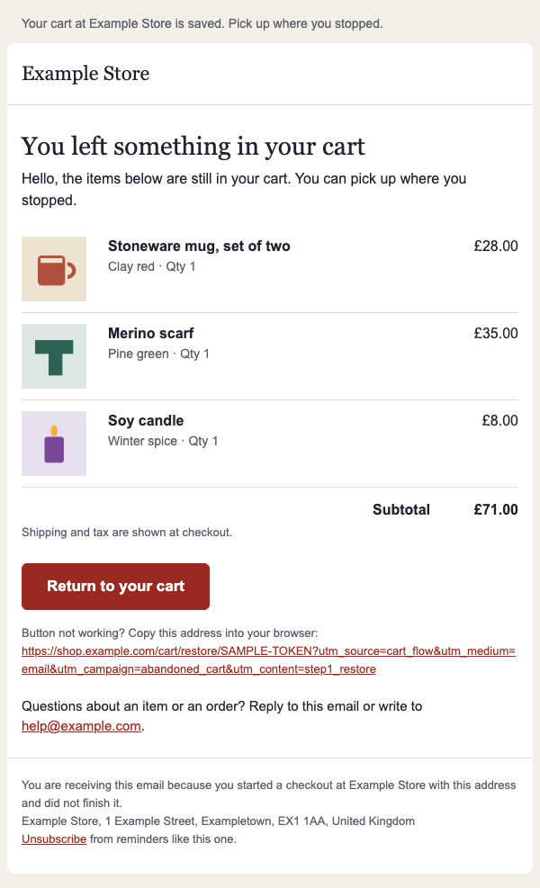

# Abandoned cart email templates: three emails, a plain-text part and a send ledger

Three HTML email templates for an abandoned cart sequence (about 1 hour, 24 hours and 48 hours after the cart was left), each with a plain-text part, plus a small send ledger that shows when an email must be skipped, cancelled or never repeated. They accompany the [iLogr](https://ilogr.com/) guide [Abandoned Cart Email Templates for the Festive Season: Three HTML Emails, Outlook and Cancel Rules](https://ilogr.com/abandoned-cart-email-templates-festive-season-three-html-emails-outlook-and-cancel-rules/).

> **Before you use it:** these templates are ideas for what abandoned cart emails could look like, not ready-made files for any particular platform or mail client. Adapting them to yours, and making them work there, is up to you. This is example code, provided as is, without warranty. Try it in a test mailbox or a staging copy first, never straight on a live store, and check the result in the mail clients your customers use. You use it entirely at your own risk. iLogr cannot see your store, and nobody who wrote or published this code accepts responsibility for damage, lost sales, delivery problems or a complaint from a regulator.



## What is here

| Path | What it is |
| --- | --- |
| `templates/` | A shared layout (`base.html`, `base.txt`), a cart-items partial, a button partial and the three email bodies |
| `dist/` | The three emails, built, with runtime `{{ placeholders }}` still in place. Starting points to adapt, not finished files for any one platform |
| `sample/cart.json` | Sample data: one cart, a `minimal` variant (no optional blocks) and a `full` variant (all optional blocks) |
| `scripts/build.py` | Builds `dist/` and `out/` and the MIME messages. Python 3.9 or later, no packages |
| `scripts/render-check.cjs` | Optional: renders every email in headless Chrome at three widths, light and dark, and checks it |
| `ledger/ledger.py` | The skip, cancel and never-repeat rules, as a runnable reference (SQLite, no packages) |
| `tests/` | 37 checks for the templates and the ledger |

The three emails:

1. **Reminder** (about 1 hour): the cart contents and one button. No discount.
2. **Questions** (about 24 hours): delivery, returns and help, an optional real customer review, the cart and the button.
3. **Last reminder** (about 48 hours): says it is the last one. Optional blocks for an honest stock note, a hold note and an incentive. The incentive block is empty unless you fill it in.

The timings are common practice, not proven best. Measure your own.

## Quick start

```bash
python3 scripts/build.py                  # writes dist/ and out/
python3 -m unittest discover -s tests -v  # 37 checks
```

Open `out/full/email-1-reminder.html` in a browser to preview. For the headless render check:

```bash
npm install
python3 scripts/build.py && node scripts/render-check.cjs
```

It drives the Google Chrome you already have (`channel: 'chrome'`) and writes screenshots to `out/screenshots/`.

## Adapting the templates

`dist/` holds the finished markup. Your platform replaces the placeholders at send time. The names are neutral; map each one to your platform's own variable.

| Placeholder | Meaning |
| --- | --- |
| `{{ store_name }}`, `{{ postal_address }}`, `{{ support_email }}` | Sender identity. CAN-SPAM requires commercial email to tell recipients where you are located, so keep a real address here |
| `{{ greeting }}` | "Hello" or "Hello Sam". Never assume a first name exists |
| `{{#items}} ... {{/items}}` | One block per cart line: `title`, `variant`, `quantity`, `price`, `image_url` |
| `{{ subtotal }}` | Cart subtotal, formatted |
| `{{ url_shop }}`, `{{ url_restore }}`, `{{ url_returns }}` | Links to your own site. Add the UTM parameters shown below |
| `{{ unsubscribe_url }}` | Opt-out link. Never add UTM parameters to it |
| `{{ delivery_promise }}`, `{{ returns_summary }}` | Email 2 copy. Write only what is true for your store on the day |
| `{{#review_quote}}`, `{{#hold_note}}`, `{{#low_stock_note}}`, `{{#incentive_text}}` | Optional blocks. Empty value, no block |

`scripts/build.py` shows one way to fill them. It escapes every value, and it raises an error for a missing variable, so a typo cannot ship.

### UTM parameters

`add_utm()` in `scripts/build.py` appends four parameters to links that lead from the email to your own site: `utm_source=cart_flow`, `utm_medium=email`, `utm_campaign=abandoned_cart` and `utm_content=<step>_<link>` (for example `step1_restore`). It keeps any query string the link already has, such as a restore token, and never overwrites a parameter that is already there. Values are lowercase with underscores, because the values are case sensitive. The unsubscribe link and `mailto:` links carry none. Change the constants at the top of the file to match your own naming.

## What the Outlook-specific parts do

The layout uses nested tables with fixed `width` attributes, `bgcolor` fallbacks, and padding on the button link with `mso-padding-alt` on its cell. A conditional comment for Outlook sets `PixelsPerInch` and removes table spacing. Rounded corners, `max-width` and the narrow-screen rules are enhancements that classic Outlook for Windows ignores, so it shows square corners and the fixed 600 pixel width.

**These templates were not opened in classic or new Outlook, and nothing here claims they work there.** The choices follow Microsoft's documentation of what the Word-based engine supports. Test in the Outlook builds your customers use before you rely on them.

## What is and is not tested

Tested by `tests/` and `scripts/render-check.cjs`:

- The markup parses and tags balance; the W3C Nu validator (version 26.11.9, via Docker) reports one error, the `xmlns:o` namespace that the Outlook comment needs, and warnings about obsolete presentation attributes (`bgcolor`, `width`, `cellpadding`, `align`) that email clients still need.
- Layout is in inline styles. The `<style>` block holds only resets, the narrow-screen rules and dark mode.
- No flexbox, grid, `<picture>`, script, form, background image, positioning, float, `calc()`, `var()` or hidden content.
- Every colour comes from one palette, and the text colour pairs meet 4.5:1 (WCAG 2.2 AA) in light and dark mode.
- Images have alt text and dimensions; every link is HTTPS or `mailto:`; UTM values are lowercase; the unsubscribe link is untagged; the restore token survives tagging.
- HTML parts stay under 100 KB; each message is `multipart/alternative` with the plain-text part first; the `List-Unsubscribe` and `List-Unsubscribe-Post` headers are present.
- In Chrome 157 (Playwright 1.62.1): no horizontal scroll at 600, 375 and 320 pixels; images load; the button is at least 44 pixels high; dark mode applies.

Not tested: any real mail client, including every Outlook, Gmail, Yahoo and Apple Mail build; blocked images; how a spam filter scores the message; your platform's own template engine; sending.

To run the validator check, start the container and run the tests:

```bash
docker run -d --rm --name vnu -p 8899:8888 ghcr.io/validator/validator:latest
python3 -m unittest discover -s tests -v
docker stop vnu
```

Without the container that one check is skipped.

## The send ledger

`ledger/ledger.py` is a reference for the rules that decide whether a due email goes out. It checks, just before each send: suppression, an order placed after the cart was last changed, an empty cart, items out of stock (dropping lines and using live prices), a frequency cap per address, a recent email from another flow, and a job running too late. A row is claimed with one conditional update before anything is sent, so two workers cannot send the same email, and a crash after the claim never causes a second send. Read the docstring at the top, then `tests/test_ledger.py`.

It is a teaching reference, not a scheduler. Port the rules to your own queue.

## Consent and deliverability

Whether a cart reminder needs consent depends on where you and your customer are, how you collected the address and what the message contains. Read the regulator's own guidance for your situation; this repository gives no legal advice. Whatever the legal basis, put an opt-out link in every message, honour opt-outs quickly, authenticate your sending domain, and keep spam complaints low.

## Licence

MIT. See `LICENSE`. More guides and examples at [github.com/ilogrblog](https://github.com/ilogrblog) and [ilogr.com](https://ilogr.com/).
